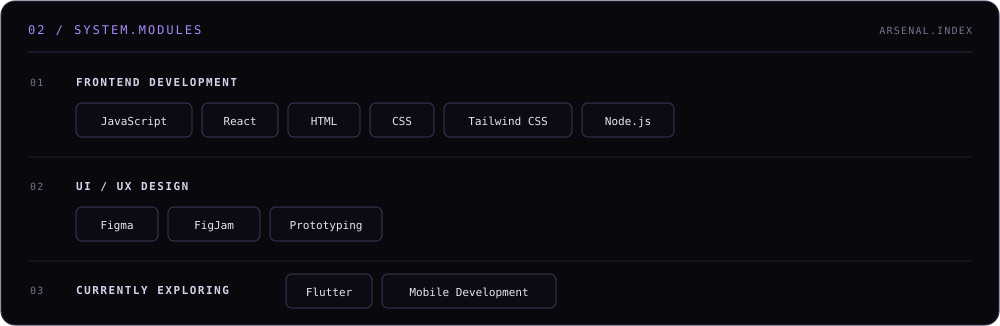
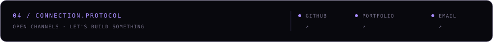

### Stack

<picture><source media="(prefers-color-scheme: dark)" srcset="assets/stack-dark.svg"><source media="(prefers-color-scheme: light)" srcset="assets/stack-light.svg"></picture>

  

### Activity

<picture><source media="(prefers-color-scheme: dark)" srcset="https://raw.githubusercontent.com/pinaaa23/pinaaa23/output/github-snake-dark.svg"><source media="(prefers-color-scheme: light)" srcset="https://raw.githubusercontent.com/pinaaa23/pinaaa23/output/github-snake.svg"></picture>

  

  <a href="https://github.com/pinaaa23">GitHub</a>
  ·
  <a href="https://itsreff.my.id/">Portfolio</a>
  ·
  <a href="mailto:refinakusuma.id17@gmail.com">Email</a>

