<picture><source media="(prefers-color-scheme: dark)" srcset="assets/banner-dark.svg"><source media="(prefers-color-scheme: light)" srcset="assets/banner-light.svg"></picture>

### Stack

<picture><source media="(prefers-color-scheme: dark)" srcset="assets/stack-dark.svg"><source media="(prefers-color-scheme: light)" srcset="assets/stack-light.svg"></picture>

### Activity

<picture><source media="(prefers-color-scheme: dark)" srcset="https://raw.githubusercontent.com/pinaaa23/pinaaa23/output/github-snake-dark.svg"><source media="(prefers-color-scheme: light)" srcset="https://raw.githubusercontent.com/pinaaa23/pinaaa23/output/github-snake.svg"></picture>

