<picture><source media="(prefers-color-scheme: dark)" srcset="assets/banner-dark.svg"><source media="(prefers-color-scheme: light)" srcset="assets/banner-light.svg"></picture>

<picture><source media="(prefers-color-scheme: dark)" srcset="assets/divider-dark.svg"><source media="(prefers-color-scheme: light)" srcset="assets/divider-light.svg"></picture>

<picture><source media="(prefers-color-scheme: dark)" srcset="assets/h-about-dark.svg"><source media="(prefers-color-scheme: light)" srcset="assets/h-about-light.svg"></picture>

<picture><source media="(prefers-color-scheme: dark)" srcset="assets/about-dark.svg"><source media="(prefers-color-scheme: light)" srcset="assets/about-light.svg"></picture>

<picture><source media="(prefers-color-scheme: dark)" srcset="assets/h-tech-stack-dark.svg"><source media="(prefers-color-scheme: light)" srcset="assets/h-tech-stack-light.svg"></picture>

<picture><source media="(prefers-color-scheme: dark)" srcset="assets/stack-dark.svg"><source media="(prefers-color-scheme: light)" srcset="assets/stack-light.svg"></picture>

<picture><source media="(prefers-color-scheme: dark)" srcset="assets/h-selected-work-dark.svg"><source media="(prefers-color-scheme: light)" srcset="assets/h-selected-work-light.svg"></picture>

| Project | What it is | Stack |
| :-- | :-- | :-- |
| **[Project One](https://github.com/YOUR_USERNAME/project-one)** | Short one-line description of what it does. | `React · Tailwind` |
| **[Project Two](https://github.com/YOUR_USERNAME/project-two)** | Short one-line description of what it does. | `Next.js · Figma` |
| **[Project Three](https://github.com/YOUR_USERNAME/project-three)** | Short one-line description of what it does. | `HTML · CSS · JS` |

<picture><source media="(prefers-color-scheme: dark)" srcset="assets/h-activity-dark.svg"><source media="(prefers-color-scheme: light)" srcset="assets/h-activity-light.svg"></picture>

<picture><source media="(prefers-color-scheme: dark)" srcset="https://raw.githubusercontent.com/YOUR_USERNAME/YOUR_USERNAME/output/github-snake-dark.svg"><source media="(prefers-color-scheme: light)" srcset="https://raw.githubusercontent.com/YOUR_USERNAME/YOUR_USERNAME/output/github-snake.svg"></picture>

<!--
OPTIONAL single stats card (public Vercel instances are often rate-limited and can show broken images,
so it is off by default). Uncomment if you want it:

  

-->

<picture><source media="(prefers-color-scheme: dark)" srcset="assets/h-connect-dark.svg"><source media="(prefers-color-scheme: light)" srcset="assets/h-connect-light.svg"></picture>

<picture><source media="(prefers-color-scheme: dark)" srcset="assets/footer-dark.svg"><source media="(prefers-color-scheme: light)" srcset="assets/footer-light.svg"></picture>

